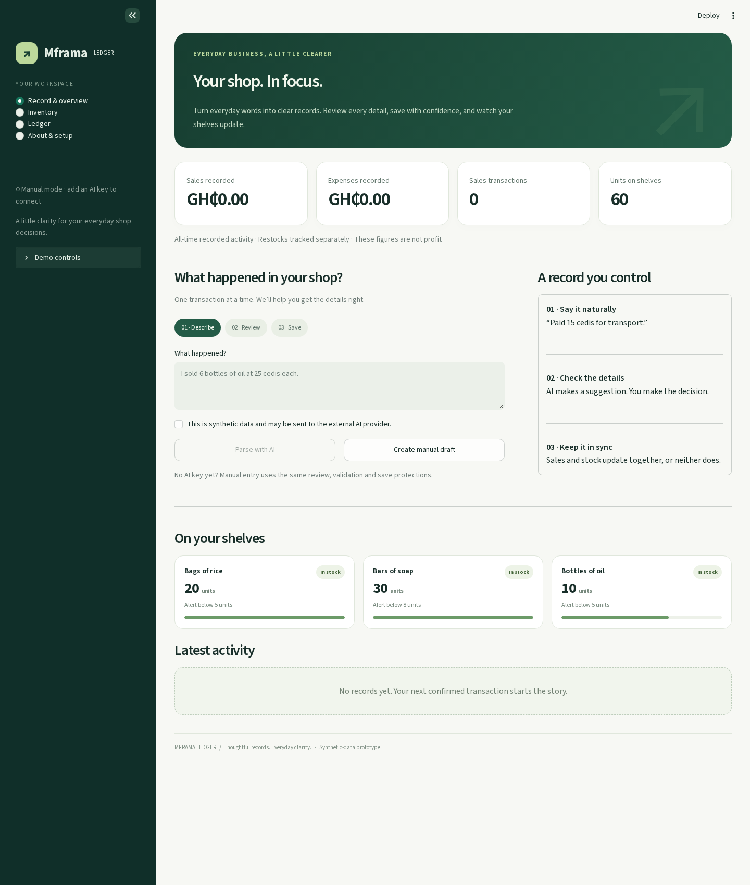
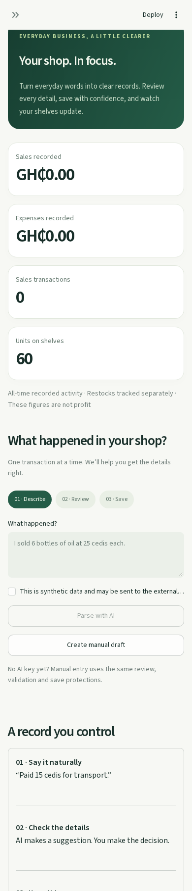
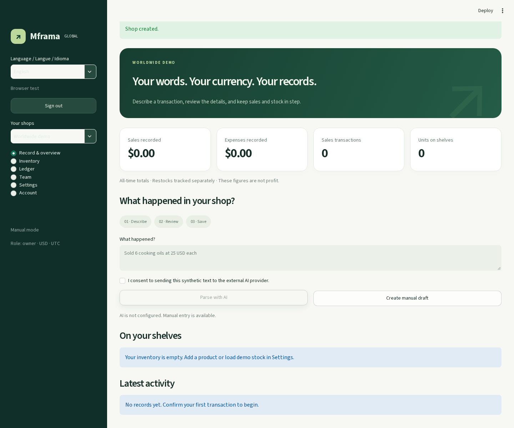
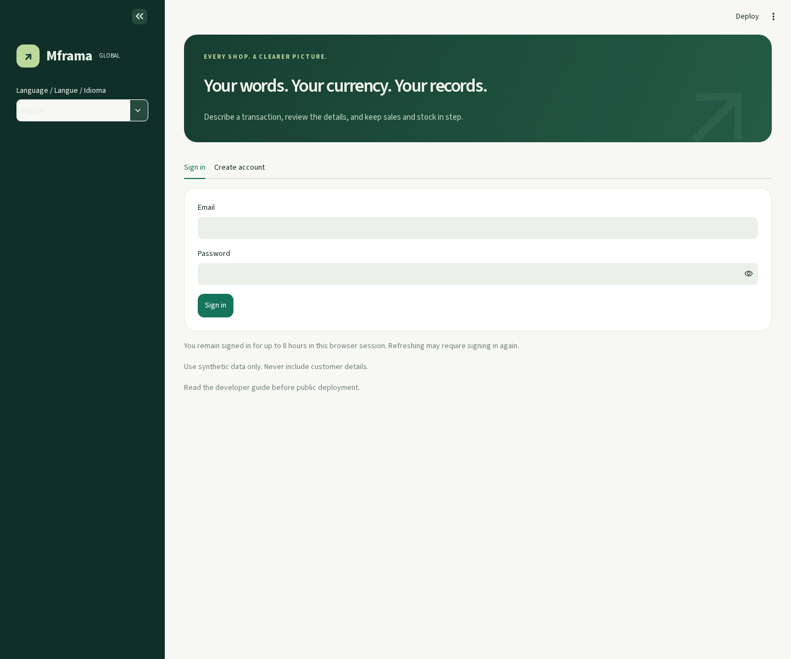
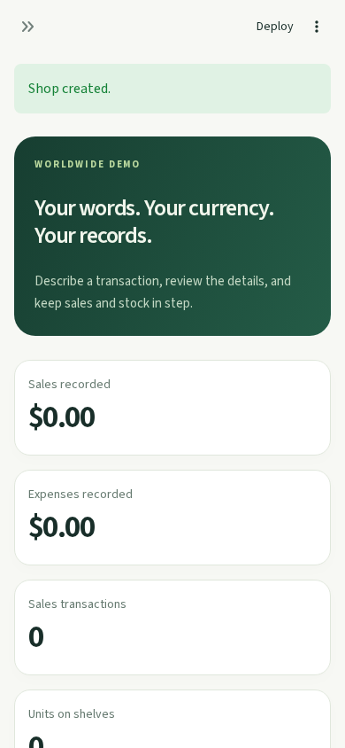

# SaySale

SaySale is a multilingual, AI-assisted sales and inventory ledger for small
shops. It turns manual descriptions, receipt images, and voice notes into
reviewable transaction drafts while keeping inventory and ledger updates
validated and atomic.

## Problem statement and solution

Small-shop owners often track sales, expenses, and stock with memory, paper, or
spreadsheets. These methods are difficult to search, easy to lose, and
especially error-prone across languages, currencies, and multiple shops.

SaySale provides a single workflow for recording and reviewing shop activity.
Owners can enter transactions manually or use AI to extract details from text,
images, and audio. The application validates the draft against the selected
shop, blocks unsafe changes such as currency mismatches and overselling, and
routes incomplete or low-confidence results to human review. It also provides
inventory runway guidance, low-stock alerts, CSV export, and a grounded AI
advisor.

## Technology stack

- **Python 3.11+**
- **Streamlit** for the web interface
- **FastAPI + Uvicorn** for authenticated webhook intake
- **SQLite** for prototype persistence
- **Google Gemini API** through `google-genai`
- **Pydantic** for structured AI response validation
- **Pandas** for tables, charts, and exports
- **Babel** for currency precision and localization
- **Pytest** for automated testing

## Team member contributions

This is a solo project. The project author handled the planning, interface and
backend implementation, database and authorization workflows, Gemini
integration, webhook processing, testing, and documentation.

## Setup and installation

### Requirements

- Python 3.11 or newer
- A Gemini API key and model name for live AI features

### Windows PowerShell

```powershell
python -m venv .venv
.venv\Scripts\Activate.ps1
python -m pip install -r requirements.txt
python -m streamlit run app.py
```

### macOS or Linux

```bash
python3 -m venv .venv
source .venv/bin/activate
python -m pip install -r requirements.txt
python -m streamlit run app.py
```

Open the local URL printed by Streamlit. Create an account, create a shop,
select its country, currency, and timezone, then add products or load the
synthetic demo inventory from **Settings → Demo data**. There are no default
credentials.

Manual transaction entry works without Gemini.

### Configuration

Set these values in the environment or in local Streamlit secrets:

```text
GEMINI_API_KEY=your-key
GEMINI_MODEL=your-model-name
```

For PowerShell:

```powershell
$env:GEMINI_API_KEY = "your-key"
$env:GEMINI_MODEL = "your-model-name"
```

Never commit API keys, SMTP credentials, `.streamlit/secrets.toml`, databases,
exports, or real records. Revoke and replace any credential that has been
exposed.

## AI methodology and implementation

SaySale uses a constrained extraction-and-review workflow. The AI model never
writes directly to the database:

1. The user explicitly consents to AI processing and supplies text, audio, or
   an image.
2. [`ai_parser.py`](ai_parser.py) sends the input and shop currency to Gemini
   using Pydantic schemas (`Draft` and `MultiDraft`).
3. The response is normalized and checked for required fields, supported
   transaction types, whole-unit quantities, currency, and confidence.
4. [`ai_automation.py`](ai_automation.py) matches products and applies the
   default 85% confidence threshold, currency checks, and oversell protection.
5. Safe drafts are committed through the authorized storage layer. Uncertain,
   incomplete, unmatched, or unsafe drafts go to Pending Review.
6. [`ai_cfo.py`](ai_cfo.py) receives bounded analytics from
   [`store.py`](store.py), not database credentials or unrestricted database
   access.

Webhook events are authenticated and deduplicated before asynchronous parsing.
They are also routed to human review rather than being posted merely because
they were received.

## AI model names and API usage

SaySale uses Google's Gemini API through the `google-genai` Python client.
The model name is configurable rather than hard-coded:

- `GEMINI_MODEL` selects the model used for transaction extraction, receipt and
  voice processing, CFO questions, and executive briefings.
- `GEMINI_API_KEY` authenticates API requests.

Text and webhook requests use JSON prompts and structured output. Receipt and
voice workflows send a media byte part with an extraction instruction. CFO
requests send precomputed shop analytics as context and request a grounded
natural-language answer.

AI output is treated as untrusted input. Missing fields, low confidence,
unknown products, currency mismatches, and oversell risks are sent for review.
Manual entry remains available when the AI provider is unavailable.

## Product screenshots

The following screenshots use synthetic demonstration data:

| View | Screenshot |
|---|---|
| Desktop dashboard | [screenshots/desktop.png](screenshots/desktop.png) |
| Mobile dashboard | [screenshots/mobile.png](screenshots/mobile.png) |
| Global dashboard | [screenshots/global-dashboard.png](screenshots/global-dashboard.png) |
| Sign-in screen | [screenshots/global-login.png](screenshots/global-login.png) |
| Global mobile view | [screenshots/global-mobile.png](screenshots/global-mobile.png) |

### Desktop dashboard



### Mobile dashboard



### Global dashboard



### Sign-in screen



### Global mobile view



Screenshots are illustrative UI previews and do not represent production
availability or measured AI accuracy.

## Validation and testing

Run the active test suite:

```bash
python -m pytest -q
```

Compile-check the Python modules:

```bash
python -m compileall -q .
```

The tests cover authentication, roles, tenant isolation, invitations,
concurrency, inventory and currency validation, exports, AI contracts,
pending-review workflows, webhooks, analytics, and selected Streamlit
journeys.

Optional live evaluation uses the synthetic cases in `evaluation.json`:

```bash
python evaluate.py
```

Live evaluation requires `GEMINI_API_KEY` and `GEMINI_MODEL`. It is a small
synthetic benchmark, not proof of calibrated confidence or production safety.

## Relevant limitations

SaySale is a prototype. Before public or financial use, add a managed durable
database, protected backups, monitoring, verified identity and recovery flows,
rate limiting, stronger deployment controls, and domain-specific accounting
review.

- SQLite is intended for a single-instance demonstration.
- Email verification, MFA, and automated password recovery are not configured.
- No foreign-exchange conversion, tax calculation, returns, or
  cost-of-goods accounting is implemented.
- Live Gemini accuracy, provider availability, quotas, latency, and pricing
  remain external dependencies.
- Use synthetic data for demonstrations; do not upload customer information.

## Repository structure

| Path | Purpose |
|---|---|
| `app.py` | Streamlit interface and workflow orchestration |
| `store.py` | SQLite schema, authorization, and atomic mutations |
| `ai_parser.py` | Structured text, image, and audio extraction |
| `ai_automation.py` | Confidence gates and inbound automation |
| `ai_cfo.py` | Grounded analytics assistant and briefings |
| `webhook_api.py` | Authenticated FastAPI webhook endpoint |
| `ui.py` | Shared presentation, charts, and CSV helpers |
| `tests/` | Automated test suite |
| `screenshots/` | Product screenshots |
